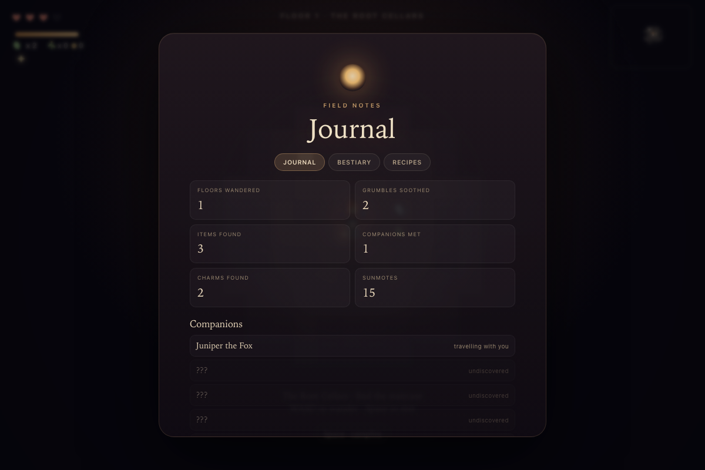

# Lantern Hollow

A small, cozy dungeon crawler that runs in the browser. No build step, no dependencies,
no assets — just Canvas 2D, a little procedural generation, and a lantern.

**Live:** <https://blakells.github.io/lantern-hollow/> · **Source:** <https://github.com/Blakells/lantern-hollow>


On an iPhone it gets a pad and two action buttons:


And each floor has a small companion waiting on a cushion:


Campfires are now a brewing menu, and chests hold lantern charms:


The Under-Gardener, a gentle floor-3 mini-boss:


Pip's cart on floors 2 and 4:


The Sunroom, where sunmotes become permanent little advantages:


The in-run journal and the Sunroom Home tab:




## Play

- **Desktop:** open `index.html` (double-click it, or `open index.html` on macOS).
- **iPhone:** open the hosted URL in Safari, tap **Light the lantern**, then
  Share → **Add to Home Screen**. The lantern icon opens it full-screen.

Optional: `index.html?seed=53#play` starts immediately on a fixed seed.

There is no account and no login. The link is the whole thing.

## Controls

| Action | Keyboard | Touch |
| --- | --- | --- |
| Walk | `WASD` / arrow keys | the pad, bottom left |
| Campfire / descend / meet | `Space` | the big gold button |
| Sip tea | `E` | **TEA** |
| Mute | `M` | — |
| Start | `Enter` | **Light the lantern** |

On a phone the big button changes label as you stand near a fire (`FIRE`), on stairs
(`DOWN`), next to a companion (`MEET` / `SWAP`), or on the Sunroom dais (`BASK`).
The campfire menu lets you **Rest** or brew tea.

## The loop

You take a lantern down five floors of the under-garden. The stairs are somewhere in
the dark, the lantern oil is always running low, and the local grumbles are having a day.

- **Walk** into a grumble to soothe it. Each bonk softens it; the last one makes it sigh,
  leave you a tea leaf, and wander off. Nothing in this dungeon needs killing.
- **Tea leaves** are your healing. Press `E` for +1 heart.
- **Red potions** restore two hearts — but only when you are hurt. At full life they wait on
  the floor for later.
- **Windflowers** double your walking speed for 15 seconds. A small timer appears under
  the tea count while it lasts.
- **Mushrooms** give +1 heart on pickup (up to four).
- **Oil flasks** keep the lantern bright. The light shrinks as the oil burns down.
- **Bitterleaf herbs** are brewing ingredients, picked up like tea leaves.
- **Campfires** open a brewing menu: rest to refill oil and hearts, or brew:
  - **Hearty tea** — 2 tea + 1 herb → +2 hearts
  - **Swift tea** — 1 tea + 1 herb → double speed for 20s
  - **Bright tea** — 1 tea + 2 herbs + 12% oil → a wider lantern for 60s
- **Treasure chests** hold one of three lantern charms, auto-equipped as you find them:
  - **Wide glow** — +15% lantern radius
  - **Warm light** — a soothe sometimes counts double
  - **Seeker light** — nearby items glimmer and appear on the minimap
- **Set-piece rooms:** every floor has one authored room. The Tea Library (read the ledger
  for tea), the Mushroom Grove (extra herbs), the Moonlit Bath (soak once for +1 heart),
  the Tea Party (pour a cup for tea and a heart), and the Gardener's Greenhouse.
- **The Under-Gardener** waits in the floor-3 greenhouse. It is not a fight: offer three
  cups of tea and it blooms, granting **+1 max heart** and a charm.
- **Buttons** are the soft currency. Soothe grumbles (+1), open chests (+2), and calm the
  Under-Gardener (+3). Spend them with **Pip the mole**, whose cart appears on floors 2 and 4:
  tea, lamp oil, bitterleaf, a honey biscuit, a charm, or a map fragment.
- **The request board** in each floor's start room holds one run-long favor: soothe three
  grumbles, gather three herbs, open a chest, meet a companion, or reach floor 3. Claim it
  there for buttons and tea.
- **Secret alcoves:** every floor hides a cracked wall in an unexplored corner of the map.
  Bump it to open a 3×3 nook with a hidden cache (+5 buttons, +2 tea, +1 sunmote, and a
  charm). A map fragment from Pip reveals it on the minimap.
- **Sunmotes** are the between-run currency. Earn them at the Sunroom, from the
  Under-Gardener, and from secret caches. Spend them in **The Sunroom** screen (title or
  ending) on permanent unlocks: start with tea, start with a lucky charm, begin with an
  extra heart, or dye your companion's collar. Saved in the browser.
- **The Journal** (`J`, or **NOTES** on touch) pauses the run with field notes: floors
  wandered, grumbles soothed, items found, companions met, charms, and discovered recipes.
  Unknown entries stay as dim silhouettes until you meet them.
- **The Sunroom Home** tab lets you furnish three fixed slots — rug, lamp, plant — with
  decor bought using sunmotes. Companions you've met lounge on the cushions. Purely cozy,
  fully persistent.
- **Stairs** take you down a floor. On the fifth floor, look for the Sunroom instead.
- **Companions:** every floor has one small animal waiting on a cushion — a fox, squirrel,
  cat, dog, or bear cub. Stand beside them and press `Space` to meet them. You can only keep
  one; if you already have a companion, the swap needs your approval in a little dialog.
- At zero hearts you simply wake up back at the fire with two hearts. There is no game over.

The locals have moods:

- **Grumbles** puff up with a `!`, shake, and lunge two tiles. Step aside, or bump them
  mid-puff for a double soothe.
- **Mopes** sleep under a little `z` until you get close, then bolt for the far corner.
- **Fusses** patrol in straight lines and turn at walls.
- A soothed grumble sometimes leaves a red potion or a windflower behind.

Companions follow you between floors, remembering the path you took. They're cosmetic for
now — a warm little presence rather than a stat buff.

## Put it online

This build is already published at <https://blakells.github.io/lantern-hollow/>. To move
or duplicate it: everything is static — a handful of small files plus icons. Any static
host works, and all of them give you HTTPS, which is required for the audio and the Home
Screen install.

### Fastest: Netlify Drop

1. Go to <https://app.netlify.com/drop>.
2. Drag the whole `cozy-dungeon` folder onto the page.
3. Netlify gives you a URL like `https://lantern-hollow-abc123.netlify.app`.
4. Make a free account to keep it and rename the site.

No command line. The URL is public but unguessable; there is no login.

### GitHub Pages

From inside `cozy-dungeon` with the GitHub CLI logged in:

```sh
git init -b main
git add .
git commit -m "Lantern Hollow"
gh repo create lantern-hollow --public --source=. --remote=origin --push

gh api -X POST repos/:owner/lantern-hollow/pages --input - <<'JSON'
{"source":{"branch":"main","path":"/"}}
JSON
```

The site appears at `https://<your-github-user>.github.io/lantern-hollow/`.
Free GitHub Pages sites are public. Private-repo Pages needs a paid GitHub plan and
the published site is still public.

### Cloudflare Pages

Dashboard → Workers & Pages → Create → Pages → **Upload assets**, or:

```sh
npx wrangler pages deploy . --project-name lantern-hollow
```

### A link that requires her email

If "log in" should mean an actual gate, put the site behind **Cloudflare Access**
(Zero Trust). It is free for small teams, sends a one-time code to an email address you
allow, and needs the site on a custom domain you have added to Cloudflare.

- Cloudflare Access → Applications → Add an application → Self-hosted.
- Policy: allow → emails → her address (and yours).
- Then only that address gets in.

Netlify's password protection is a paid feature. A password box written in JavaScript
is cosmetic and not real security.

### iPhone notes

- Tap **Light the lantern** once before playing; iOS only starts audio from a tap.
- **Add to Home Screen** uses `apple-touch-icon.png` and the manifest, and opens
  without Safari's toolbars.
- If Safari reloads the page while she is switching apps, the run restarts — there is
  no save file yet.
- The layout adapts to portrait and landscape, and respects the notch and home indicator.

## Under the hood

- `world.js` — seeded rooms-and-corridors generation, BFS reachability, item and
  grumble placement. Pure functions, testable in Node.
- `game.js` — game loop, grid movement with tweening, bump-to-soothe combat, lantern
  lighting, particles, HUD, minimap, touch controls, WebAudio blips, companion follower
  and approval dialog.
- Companions are generated one per floor in `world.js`; a breadcrumb trail of the player's
  steps keeps the follower from cutting through walls. Swapping is a DOM dialog that pauses
  the run until you explicitly approve it.
- Rendering is smoother now: up to 2.5× device pixel ratio, soft radial shadows, seamless
  mottled floors, ambient occlusion at wall edges, and rounded masonry instead of hard tiles.
- Brewing, chests, and charms live in `G` as ingredients/timers/flags; the fire and chest
  menus pause the run with the same dialog layer as companion swaps.
- Every floor reserves one room for a set piece (`world.setPiece`), with a blocking focus
  (desk, teapot, planter) or boss, drawn by `drawSetPiece`/`drawBoss`. Set-piece rooms are
  kept free of grumbles so they stay calm.
- The merchant and request board are blocking world entities with their own dialogs. One
  favor per run is tracked in `G.favor`; event hooks advance it from soothing, herb pickups,
  chests, companion swaps, and descending.
- Secret alcoves are carved by `world.js` as isolated 3×3 pockets with a single cracked wall
  tile. The pocket is kept hidden until opened or mapped; the cracked wall becomes floor when
  bumped.
- Meta progression is one localStorage record (`lantern-hollow-meta-v1`): sunmotes, unlocks,
  journal, home, and settings. It survives reloads and never changes a run already in
  progress (start-of-run unlocks apply on the next run).
- Journal discoveries are recorded from gameplay events into that same meta record. The Home
  tab renders a small canvas room with three slots and the companions you've met.
- `style.css` / `index.html` — the title and ending cards, the touch pad, safe-area
  insets, and the web-app metadata.
- `manifest.webmanifest` + `icon*.png` — installable Home Screen app.
- Lighting is a second canvas: fill it dark, punch soft holes with
  `destination-out`, composite it over the scene.
- Music is a generative F-major loop (Fmaj7 · Cmaj7 · Dm7 · Bbmaj7) built from WebAudio
  oscillators, a soft pad, a pentatonic melody, and a feedback delay. No audio files.
- Five floor themes (Root Cellars → Sunroom) are just palettes; generation is shared.

Roughly 6,500 lines total, no libraries.

### Tests

```
node test-world.js
```

Checks 1,200 generated floors: borders sealed, every goal/item/enemy/companion/chest/
set-piece focus reachable, a secret alcove with a carved pocket and reachable approach,
one oil flask, one red potion, and one herb minimum, a favor board on every floor, a
merchant on even floors, correct goal per floor.

## Honest limits

This is a **vertical slice**, not a finished game:

- Art is procedural geometry, not illustration. Sound effects and music are synthesized
  WebAudio, not recorded audio.
- Runs still do not save mid-run; refresh restarts a run. Meta (sunmotes, unlocks, journal,
  home, settings) does persist.
- Companions are cosmetic; they do not grant buffs or fight.
- No login, accounts, or cloud saves. A hosted link is the only access control.
- Touch and keyboard; no controller.
- Balance is first-pass; the fifth floor is a difficulty bump but not a wall.
- Tested in an iPhone-sized browser emulator, not yet on physical iOS hardware.

The fun part — the loop, the lighting, the tone — is here. The expensive part —
content, art, sound, and polish — is what turns it into something you'd sell.

### Easy places to tune

- `world.js` → `wanted` room count, enemy `count`, item weights, floor size.
- `game.js` → `THEMES` (palette + floor names), oil drain `dt * 0.0045`,
  lantern radius `2.1 + oil * 2.5`, movement `dt / 0.14`.
- `style.css` → type, colors, touch-button sizes, and the title/ending cards.
